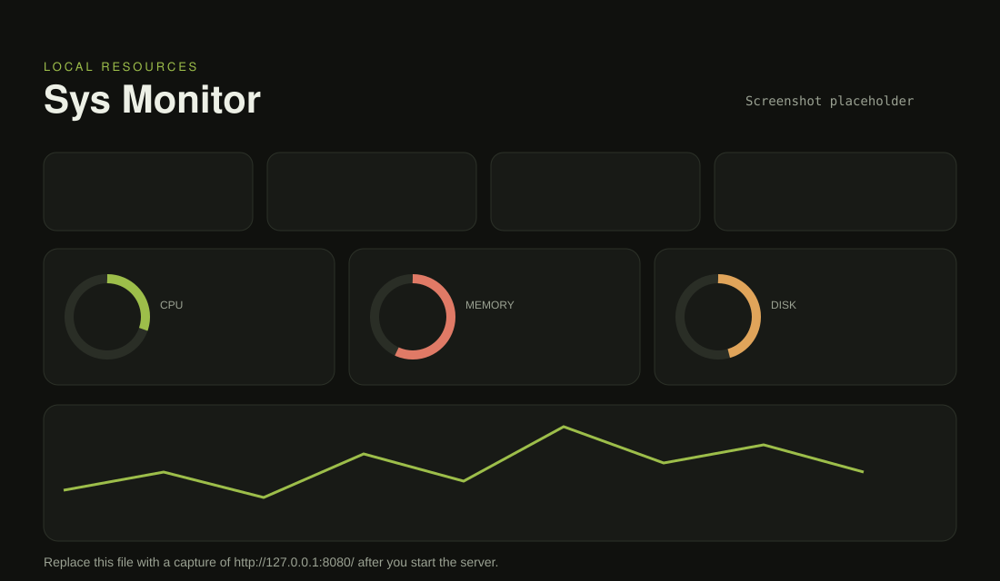

# Sys Monitor


A local resource dashboard for CPU, memory, disk, uptime, and process count. Python's `http.server` serves `index.html` and `dashboard.js`. The markup and theme live in the HTML file. The gauges, canvas history, and live updates live in the script. Nothing is loaded from a CDN, and nothing is installed with pip.

## Run

```bash
cd 8-sys-monitor-panel
python server.py
```

The process prints `Collecting the first sample...` and then a URL, by default:

```text
http://127.0.0.1:8080/
```

Open that URL. The first sample can take a few seconds while Windows CIM starts. After that, the page updates about once a second. Stop the server with Ctrl+C.

```bash
python server.py --host 127.0.0.1 --port 8080
```

The bind address stays on localhost unless you pass another `--host`.

## What you see



The image above is a layout placeholder. Replace `screenshot.svg` with a capture of the live page if you want a photograph of your own desktop in the README.

Gauges turn red at 90 percent. The chart keeps the last 60 samples. On Windows the load card shows the logical CPU count, because Windows has no `/proc/loadavg`. On Linux it shows the 1, 5, and 15 minute load averages.

## Endpoints

| Path | Response |
| --- | --- |
| `/` | `index.html` |
| `/api/stats` | One JSON sample. Handlers read a cached snapshot, so this stays cheap. |
| `/api/events` | `text/event-stream`, one `data:` event per second, chunked HTTP/1.1 |

The page opens an `EventSource` on `/api/events`. If no event arrives within 2.5 seconds, it closes that stream and polls `/api/stats` every second. The status line shows which path is active: `SSE /api/events · 1s` or `Polling /api/stats · 1s`.

A background thread named `sys-monitor-sampler` refreshes the snapshot about once a second, so a slow operating-system query is not repeated for every browser request.

## Where the numbers come from

**Linux.** `/proc/stat` (idle plus iowait, differenced between samples; the first CPU reading is 0), `/proc/meminfo` (`MemAvailable`, or `MemFree` when available is absent), `/proc/uptime`, `/proc/loadavg`, numeric entries in `/proc` for the process count, and `os.statvfs("/")` for disk.

**Windows.** One PowerShell CIM query: `Win32_Processor.LoadPercentage` averaged across CPUs, `Win32_OperatingSystem` for memory (KB converted to bytes), process count, and boot time, and `Win32_LogicalDisk` for `%SystemDrive%`. If PowerShell fails, the sampler falls back to `wmic`. A CIM call often takes 1–2 seconds, so the chart can step a little slower than the one-second poll while still serving the last good snapshot immediately.

Other operating systems are outside this collector. The sampler records the error on the snapshot, and the page prints it.
